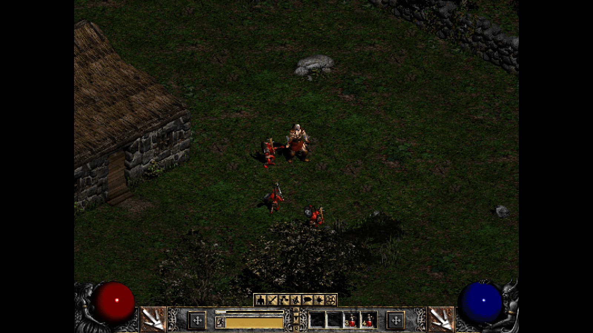
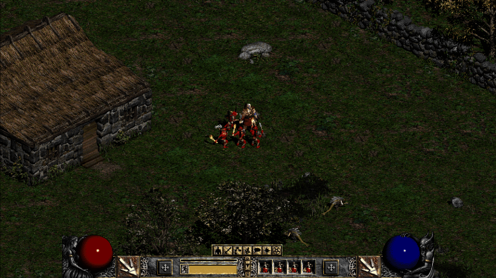
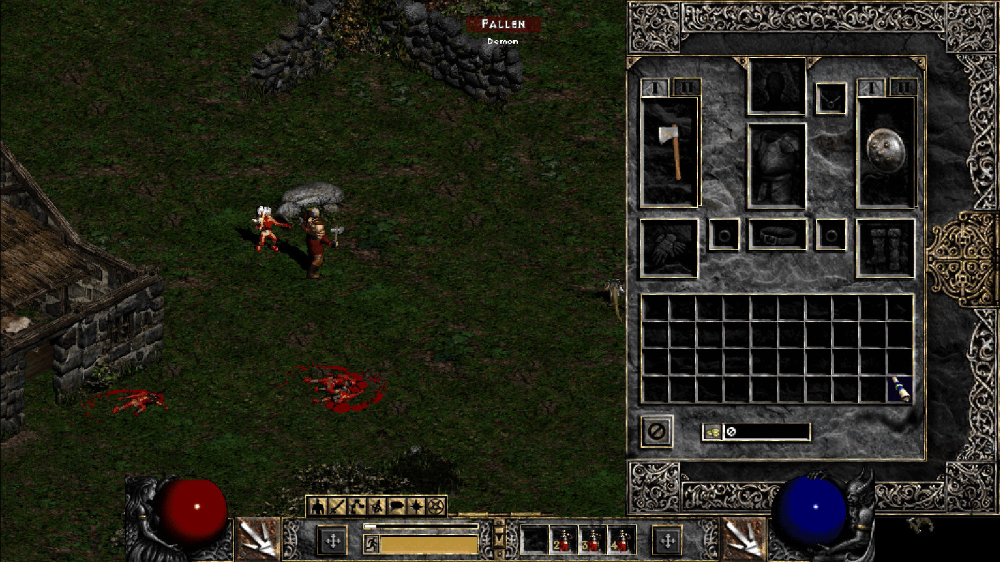
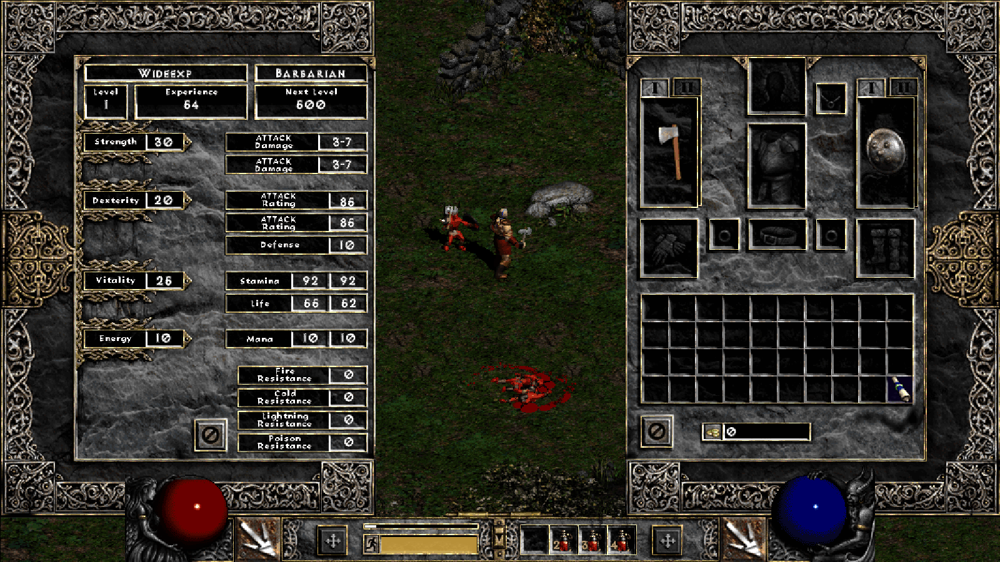

# D2R Legacy 16:9

A D2RLoader plugin that shows the classic (legacy) graphics of Diablo II: Resurrected in 16:9 instead of 4:3.
The bottom control panel stays 4:3 and centred.

Blood Moor in the classic graphics at 800x600, same spot. Before (stock D2R, 4:3 with side bars):



After (legacy169, 1066x600):



Side panels sit at the window edges (inventory; character and inventory):




- 800x600 shows as 1066x600, 640x480 as 853x480 (16:9 at the same height). The width follows the screen: a 16:10
  screen gets 960x600 and 768x480, so nothing at the edges is cut off. Wider than 16:9 stays at 16:9 with side bars.
- Needs Diablo II: Resurrected 3.3 or 3.4 (builds 93847 and 95032) under D2RLoader 1.3.1. On any other game version the plugin loads,
  logs why and changes nothing. Works without a mod and next to other plugins that do not patch the same bytes.
- Offline / single player (D2RLoader).

## Install

1. Install D2RLoader 1.3.1 and start the game through it once.
2. Put `legacy169.dll` into `<game>\d2rloader\plugins\` (all mods, and plain D2R) or
   `<game>\mods\<mod>\d2rloader\plugins\` (one mod).
3. Start the game, then press G in game (or pick the legacy graphics in Options) and choose 800x600 or 640x480 under
   Options > Video > Legacy Resolution as usual.

To remove it, delete `legacy169.dll` (and `legacy169.toml` from the matching `d2rloader\config\` folder).

## Settings

D2RLoader writes the default `legacy169.toml` into the matching `d2rloader\config\` folder on the first start (the
same file is in this repository). Changes apply at the next game start.

```toml
[legacy169]
enabled = true       # false: load but patch nothing (the game keeps its 4:3 classic view)
reset_screen = true  # set the classic screen up again when D2R did it before the plugin loaded
aspect = "auto"      # the screen shape the classic picture is widened to: "auto", "16:10", "1920x1200", ...
```

`aspect = "auto"` takes the shape of the monitor the game window is on (the primary monitor while there is no window
yet). A game in a window of another shape than its monitor should name the window's shape, e.g. `aspect = "16:10"`
for a 1600x1000 window. The value is clamped to 4:3 .. 16:9; at 4:3 the plugin changes nothing.

The plugin writes its own D2RLoader log (`legacy169.log` in `d2rloader\logs\`). The console command `legacy169` prints
its status; `legacy169 mode 0` / `legacy169 mode 1` switch the classic resolution (853x480 / 1066x600 at 16:9).

## Known limits

- Only Diablo II: Resurrected 3.3 (build 93847) and 3.4 (build 95032) under D2RLoader 1.3.1. Any other version: the log says why and the game
  is not changed. The same happens when another plugin already changed one of the patched bytes.
- At most 16:9; a wider window keeps side bars. The width is chosen at game start: after moving the game to a monitor
  of another shape, restart it. D2R fits the picture to the window height, so an `aspect` wider than the window cuts
  its sides off (portraits on the left, the clock and area name on the right).
- Some shapes between 16:10 and 16:9 get a width a few pixels narrower than the screen (the panel shift must stay
  exact at both classic widths); the rest is a thin side bar.
- Legacy graphics need a Classic or Expansion character; D2R does not offer them for "Reign of the Warlock" characters
  (choose Expansion in the Game Version list when you create the hero).
- The bottom control panel stays 800 (640) pixels wide by design; the world shows beside it.
- Offline / single player only (D2RLoader).

## How it works

D2R renders the classic engine into a fixed SD target (640x480 or 800x600) and composes it into the window with a 4:3
fit. The plugin changes the width immediates of the two screen-size setters and of the SD renderer's size switches, and
points the compose pass's 4:3 constant at its own width/600 float (1066/600 at 16:9, 960/600 at 16:10). Mouse mapping, culling and the cursor read the
screen-size globals, so they follow. Every site is listed in [src/patch_table.h](src/patch_table.h) with the bytes it
expects; all patches go in as one D2RLoader transaction or not at all.

- The tile cull reaches past the bottom panel (as SGD2FreeRes does), so the bottom corners beside the 4:3 panel show
  the world instead of black wedges.
- Side panels sit at the window edges: the profile loader is hooked and the panel anchors of `_profileSD.json` are
  rewritten after D2R parses it (only the stock 0.5 values; the anchors are computed for the chosen width). At the
  wide width the 800x600 frame stays beside them (the
  BordersPanel draw is hooked and moves the right frame and its click catcher to the right edge).
- With a panel open the view shifts by the stock 200 / 160 pixels instead of a quarter of the wider screen. The automap
  overlay uses the same shift (its centre helper and the two width calls of AutoMapPanel::Draw).
- HUD widgets anchored to the screen centre (Help button, message log, NPC speech, menus) keep their 800x600 place
  relative to the control panel.
- The hooks check their entry bytes like the patches and are not installed on another build.

## Build

Windows x64, CMake 3.29+, Visual Studio 2026 (MSVC), and a checkout of the D2RLoader PluginSDK:

```powershell
pwsh tools/build.ps1 -Sdk <PluginSDK folder> [-Image <D2R image dump>]
```

Output: `build\Release\legacy169.dll`. The script also runs the unit tests (`build\tests\Release\legacy169_tests.exe`);
with `-Image` they check every expected byte range against a dump of the game image.

Test builds (never ship them; their version reads `0.1.1-test`):

- `-Test` (output `build-test\`): adds a background-input harness so scripted checks can drive the game while it is not
  the foreground window. It only runs when `legacy169-testharness.txt` sits next to the DLL.
- `-BadBytes` (output `build-bad\`): the last patch expects a wrong byte, to check that the plugin refuses the whole
  table, logs it and leaves the game unchanged.

The release build contains neither.

## Credits

- D2RLoader and its PluginSDK: plugin loading, patch transactions, config and log.
- SGD2FreeRes for the idea of extending the tile cull past the bottom panel in the classic engine.
- Blizzard Entertainment for Diablo II and Diablo II: Resurrected. This plugin contains no game files.

## License

MIT ([LICENSE](LICENSE)). Diablo II and Diablo II: Resurrected belong to Blizzard Entertainment; this project is not
affiliated with or endorsed by Blizzard Entertainment or the D2RLoader project.
